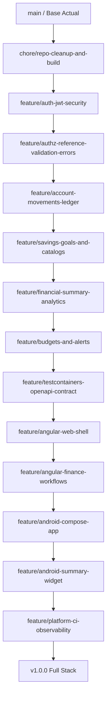
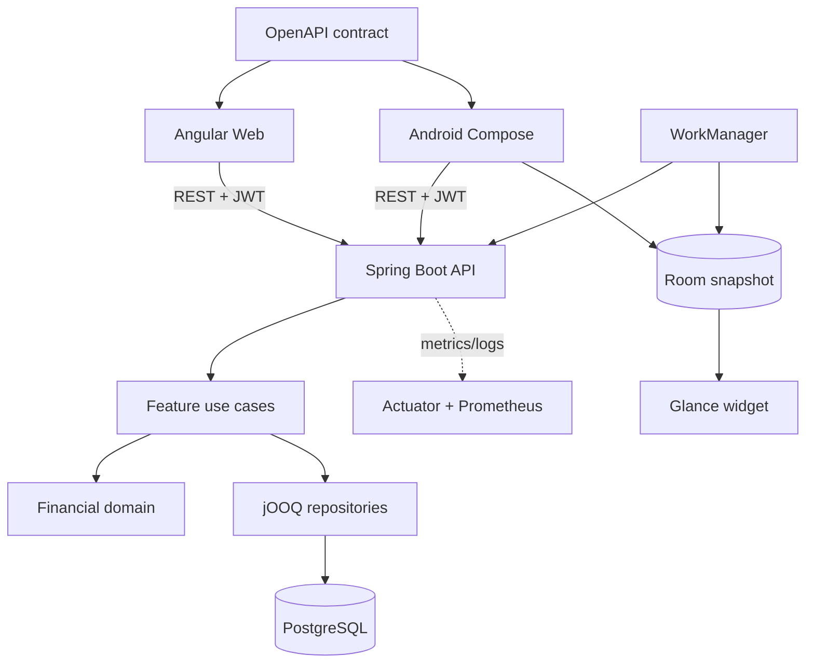

# Hoja de ruta full stack de Planora

> **Propuesta de trabajo futuro:** este documento describe funcionalidades y ramas planificadas; no implica que estén implementadas ni crea las ramas mencionadas.

Para conocer el estado verificable actual, consulta [Planora en el CV y portafolio](PORTFOLIO.md). El diagnóstico técnico detallado del backend está disponible en [Análisis y plan de finalización del backend](BACKEND_ROADMAP.md).

### Overview & Goals
El objetivo es convertir **Planora** en un producto full stack de portafolio, organizado en **ramas Git temáticas** (sin crearlas) y con una progresión que permita aprender cada tecnología con un entregable demostrable.

Primero se cerrará el núcleo Spring Boot; después se incorporarán presupuestos y alertas, una web Angular y una aplicación Android nativa con widget de resumen. iOS y escritorio nativos quedan como evolución posterior, evitando dispersar el esfuerzo antes de disponer de una v1 verificable.

---

### Scope

#### In Scope
- **Seguridad & Autenticación:** Flujo JWT completo (emisión, validación, autorización stateless, manejo de 401/403 y CORS).
- **Control de Acceso & Autorización:** Prevención de Broken Object Level Authorization (BOLA) en referencias cruzadas (cuentas, categorías, compras y gastos).
- **Core Financiero & Saldos:** Libro mayor de movimientos (`account_movement`), cálculo y actualización atómica de saldos, transacciones ACID, y validación de monedas.
- **Módulos Financieros:** Metas de ahorro, catálogos, resumen mensual y un nuevo módulo de presupuestos por categoría/período con umbrales y alertas.
- **Resiliencia & Errores:** Manejo de excepciones RFC 7807, concurrencia optimista e idempotencia.
- **Contrato Compartido:** OpenAPI 3.0 como fuente del cliente TypeScript/Kotlin y de la documentación Swagger UI.
- **Web:** Aplicación Angular responsive con dashboard, autenticación, cuentas, gastos, compras, metas, presupuestos y analítica.
- **Android:** Aplicación Kotlin + Jetpack Compose para los flujos principales y widget Android con Jetpack Glance.
- **Calidad & Operación:** Testcontainers, tests de frontend/móvil, Docker, GitHub Actions, Actuator, Micrometer y logs estructurados.

#### Out of Scope
- Microservicios, Kubernetes o Kafka (el proyecto es y debe mantenerse como un monolito modular limpio y eficiente).
- Sustitución de jOOQ por JPA/Hibernate (jOOQ es la tecnología central elegida para SQL tipado y control fino de consultas).
- Aplicación iOS/WidgetKit y clientes nativos de Windows/macOS/Linux en la v1; serán ramas futuras tras validar Android.
- Sincronización offline completa, agregación bancaria/Open Banking y pasarelas de pago reales.
- Compartir UI entre Angular y Android: ambos comparten contrato, no framework ni componentes.

---

### User Stories & Acceptance Criteria

1. **Autenticación & Seguridad:**
   - *Como usuario*, quiero registrarme e iniciar sesión con credenciales válidas y recibir un token de acceso seguro para interactuar con mis datos protegidos.
   - *Criterio de aceptación:* Endpoints `/api/auth/register` y `/api/auth/login` funcionales; peticiones sin token o con token alterado/expirado reciben `401 Unauthorized`.

2. **Aislamiento Multi-inquilino (Seguridad de Datos):**
   - *Como usuario*, solo debo poder ver, modificar y vincular cuentas, categorías, compras y gastos que me pertenezcan.
   - *Criterio de aceptación:* Un usuario A no puede asignar una cuenta del usuario B en sus compras o gastos; el sistema rechaza la operación con `404` o `403` sin revelar información privada.

3. **Consistencia Financiera & Saldos:**
   - *Como usuario*, cuando registre un gasto o complete una compra, el saldo de las cuentas involucradas debe actualizarse de manera exacta y atómica, registrando el movimiento en el historial.
   - *Criterio de aceptación:* Una compra completada con pagos parciales descuenta exactamente los montos correspondientes; cualquier error transaccional produce rollback total sin inconsistencias de saldo.

4. **Metas de Ahorro & Reportes:**
   - *Como usuario*, quiero definir metas de ahorro con fecha y monto objetivo, realizar aportes y consultar mi progreso, además de ver un resumen financiero mensual consolidado.
   - *Criterio de aceptación:* CRUD y aportes de metas funcionando contra PostgreSQL; resumen mensual calculado en base de datos sin duplicar transacciones.

5. **Presupuestos & Alertas:**
   - *Como usuario*, quiero fijar límites mensuales por categoría y recibir avisos al aproximarme o superar el límite.
   - *Criterio de aceptación:* el backend calcula consumo y porcentaje sin duplicar compras/gastos; cada usuario solo accede a sus presupuestos y las alertas no se duplican.

6. **Experiencia Web:**
   - *Como usuario*, quiero completar desde una web responsive registro, login y los flujos financieros principales con estados de carga, vacío y error accesibles.
   - *Criterio de aceptación:* Angular consume exclusivamente el contrato REST generado desde OpenAPI y cubre el recorrido autenticado crítico mediante tests E2E.

7. **Android & Widget:**
   - *Como usuario Android*, quiero consultar y registrar mis finanzas, y ver saldo, gasto mensual y presupuesto restante desde un widget.
   - *Criterio de aceptación:* Compose consume la API autenticada; Glance muestra datos cacheados, oculta información sensible cuando corresponde y abre la pantalla relevante.

8. **Experiencia de Desarrollador & Portafolio:**
   - *Como evaluador técnico*, quiero clonar el repositorio, ejecutar la solución y verificar backend, web y pruebas con instrucciones reproducibles.
   - *Criterio de aceptación:* CI valida cada aplicación, `docker compose up` levanta la demo web/API y el README distingue funciones implementadas de futuras.

## Technical Design

### 1. Stack Tecnológico Global del Proyecto

El proyecto está diseñado bajo un enfoque **Modern Java Enterprise Monolith**, combinando alto rendimiento, tipado estricto en SQL y estándares de la industria:

| Capa / Dominio | Tecnología / Herramienta | Versión / Detalle | Razón & Aprendizaje |
| :--- | :--- | :--- | :--- |
| **Lenguaje** | Java 21 LTS | OpenJDK 21 | Records, Pattern Matching, Virtual Threads (evaluable), Sealed Classes |
| **Framework Base** | Spring Boot 3.x / 4.x | Web, Validation, Actuator | Estándar de la industria para microservicios y monolitos modulares |
| **Seguridad** | Spring Security 6 + JJWT | io.jsonwebtoken:jjwt | Stateless JWT Security, filtros de seguridad, `SecurityContextHolder` |
| **Base de Datos** | PostgreSQL 16+ | PostgreSQL Server | Tipos avanzados (`UUID`, `citext`, `numeric`), integridad referencial |
| **Capa SQL / DAO** | jOOQ | jOOQ 3.21+ (Codegen + DSL) | SQL tipado en tiempo de compilación, queries complejas sin la sobrecarga de un ORM |
| **Migraciones** | Flyway | Flyway 13+ | Versionamiento de esquemas SQL inmutables y trazabilidad |
| **Testing de Integración** | Testcontainers | PostgreSQL Container | Tests reales y efímeros contra un motor PostgreSQL idéntico al de producción |
| **Documentación API** | Springdoc OpenAPI | OpenAPI 3.0 / Swagger UI | Especificación viva de endpoints, esquemas, ejemplos y auth Bearer |
| **Observabilidad** | Micrometer + Actuator | Prometheus / Logback JSON | Métricas de JVM/HTTP, health checks y trazabilidad con MDC (Correlation IDs) |
| **Web** | Angular + TypeScript | Angular CLI, standalone components, Signals/RxJS, Angular Material | Arquitectura frontend empresarial, formularios, routing y accesibilidad |
| **Datos Web** | Angular HttpClient + OpenAPI Generator | Cliente TypeScript generado, interceptores y guards | Contrato tipado sin duplicar DTOs manualmente |
| **Android** | Kotlin + Jetpack Compose | Navigation, ViewModel, Coroutines/Flow, Hilt, Retrofit/OkHttp, Room | Arquitectura móvil nativa, asincronía y caché local |
| **Widget Android** | Jetpack Glance + WorkManager | Estado cacheado y actualización periódica | Widgets nativos, límites del sistema y privacidad |
| **Testing UI** | Vitest/Jest + Testing Library, Playwright, JUnit/Compose UI | Unitarios, componentes y E2E | Pirámide de pruebas entre API y clientes |
| **Contenedores & CI** | Docker + GitHub Actions | Multi-stage Dockerfile y jobs por aplicación | Automatización de compilación, tests y packaging |

---

### 2. Estructura y Mapa de Dependencia entre Ramas

---

### 3. Detalle de Ramas, Tecnologías por Rama y Objetivos de Aprendizaje

#### **Rama 0: `chore/repo-cleanup-and-build`**
- **Propósito:** Sanitizar el repositorio, gestionar secretos con seguridad y hacer que la compilación de Gradle sea reproducible en cualquier máquina o CI sin depender de archivos `.env` locales forzados.
- **Tecnologías involucradas:**
  - Gradle (Kotlin DSL `build.gradle.kts`): Configuración desacoplada de tareas `flywayMigrate` y `jooqCodegen`.
  - Git / Gitignore: Filtrado de secretos y claves criptográficas (`.env`, `infra/docker/secrets/`).
- **Qué aprenderás:**
  - Buenas prácticas de seguridad en repositorios abiertos (OWASP Secrets Management).
  - Configuración avanzada de Gradle y variables de entorno dinámicas.
- **Archivos afectados:**
  - `.gitignore`, `LICENSE`, `infra/docker/.env.example`, `backend/build.gradle.kts`.

---

#### **Rama 1: `feature/auth-jwt-security`**
- **Propósito:** Implementar la infraestructura completa de autenticación y autorización Stateless mediante JSON Web Tokens (JWT).
- **Tecnologías involucradas:**
  - **Spring Security 6:** `SecurityFilterChain`, `AuthenticationManager`, `DaoAuthenticationProvider`, `AuthenticationEntryPoint`, `AccessDeniedHandler`.
  - **JJWT (Java JWT - io.jsonwebtoken):** Firma criptográfica HMAC-SHA256, parseo de claims, validación de expiración (`exp`), emisor (`iss`) y sujeto (`sub`).
  - **BCrypt / Argon2 Password Hashing:** Almacenamiento seguro de contraseñas.
- **Qué aprenderás:**
  - Cómo funciona internamente la cadena de filtros de Spring Security (`OncePerRequestFilter`).
  - El ciclo de vida de un JWT, estructura (Header, Payload, Signature) y mitigación de ataques comunes.
  - Inyección del usuario autenticado en los controladores mediante `@AuthenticationPrincipal` o `CurrentUser`.
- **Archivos creados / modificados:**
  - `backend/src/main/java/com/planora/backend/common/security/jwt/JwtTokenProvider.java`
  - `backend/src/main/java/com/planora/backend/common/security/jwt/JwtAuthenticationFilter.java`
  - `backend/src/main/java/com/planora/backend/common/security/SecurityConfig.java`
  - `backend/src/main/java/com/planora/backend/auth/api/AuthController.java` (Login con respuesta DTO `AuthResponse` con access token)
  - `backend/src/main/java/com/planora/backend/common/security/SecurityCurrentUser.java`

---

#### **Rama 2: `feature/authz-reference-validation-errors`**
- **Propósito:** Eliminar vulnerabilidades de Broken Object Level Authorization (BOLA / IDOR) en compras y gastos, y estandarizar las respuestas de error bajo el estándar RFC 7807 (Problem Details).
- **Tecnologías involucradas:**
  - **Spring Web / RFC 7807 (ProblemDetail):** Estandarización de errores HTTP en Spring 6 (`@ControllerAdvice`, `ProblemDetail`).
  - **Jakarta Validation:** Validación declarativa de rangos, importes y formatos.
  - **Domain-Driven Design (DDD) Error Handling:** Excepciones de dominio mapeadas a códigos HTTP semánticos (400, 401, 403, 404, 409, 422).
- **Qué aprenderás:**
  - OWASP API Security Top 10 (específicamente Broken Object Level Authorization).
  - Patrón de validación de referencias de entidades en capas de aplicación (`ReferenceValidator`).
  - Diseño de contratos de error predecibles para clientes móviles y frontend.
- **Archivos creados / modificados:**
  - `backend/src/main/java/com/planora/backend/purchase/application/PurchaseReferenceValidator.java`
  - `backend/src/main/java/com/planora/backend/purchase/application/payment/add/AddPurchasePaymentService.java`
  - `backend/src/main/java/com/planora/backend/purchase/application/item/add/AddPurchaseItemService.java`
  - `backend/src/main/java/com/planora/backend/common/exception/GlobalExceptionHandler.java`
  - `backend/src/main/java/com/planora/backend/common/exception/DomainException.java` y derivadas (e.g. `InvalidStateTransitionException`, `ResourceConflictException`).

---

#### **Rama 3: `feature/account-movements-ledger`**
- **Propósito:** Implementar el libro mayor de movimientos (`ledger`), garantizando trazabilidad transaccional inmutable para todos los ingresos, egresos y compras, con consistencia de saldos y validación de divisas.
- **Tecnologías involucradas:**
  - **jOOQ Transactions & Spring Transaction Management:** Control transaccional `@Transactional` a nivel de caso de uso con jOOQ DSLContext.
  - **PostgreSQL Inmutable Ledger Schema:** Tabla `account_movement` con auditoría y tipos de movimiento.
  - **BigDecimal Math:** Aritmética financiera con precisión fija (`NUMERIC(19,4)`), redondeo explícito (`RoundingMode.HALF_UP`).
- **Qué aprenderás:**
  - Patrón de diseño contable / Ledger (Double-entry / Movement History) aplicado a aplicaciones financieras.
  - Manejo de transacciones ACID y atomicidad con jOOQ y Spring.
  - Cómo evitar inconsistencias de redondeo y pérdida de precisión monetaria.
- **Archivos creados / modificados:**
  - `database/src/main/resources/db/migration/V6__account_movements.sql`
  - `backend/src/main/java/com/planora/backend/movement/domain/AccountMovement.java`
  - `backend/src/main/java/com/planora/backend/movement/repository/jooq/JooqAccountMovementRepository.java`
  - `backend/src/main/java/com/planora/backend/purchase/application/complete/CompletePurchaseService.java`
  - `backend/src/main/java/com/planora/backend/expense/application/create/CreateExpenseService.java`

---

#### **Rama 4: `feature/savings-goals-and-catalogs`**
- **Propósito:** Desarrollar el módulo completo de Metas de Ahorro (`savings_goals`), permitiendo definir objetivos, registrar aportes/retiros y monitorear el progreso, además de exponer endpoints de catálogos (`currencies`, `account_types`).
- **Tecnologías involucradas:**
  - **jOOQ DSL:** Operaciones CRUD tipadas y consultas de agregación sobre `savings_goal` y `savings_goal_contribution`.
  - **Hexagonal / Clean Architecture:** Dominio puro, casos de uso, repositorios con jOOQ y controladores REST.
- **Qué aprenderás:**
  - Implementación de un flujo completo de feature slice (API → Use Case → Domain → Repository con jOOQ).
  - Manejo de estados de entidades de negocio (Activa, Completada, Cancelada) y aportes acumulativos.
- **Archivos creados / modificados:**
  - `backend/src/main/java/com/planora/backend/savingsgoal/domain/SavingsGoal.java`
  - `backend/src/main/java/com/planora/backend/savingsgoal/domain/SavingsGoalContribution.java`
  - `backend/src/main/java/com/planora/backend/savingsgoal/application/...`
  - `backend/src/main/java/com/planora/backend/savingsgoal/repository/jooq/JooqSavingsGoalRepository.java`
  - `backend/src/main/java/com/planora/backend/savingsgoal/api/SavingsGoalController.java`
  - `backend/src/main/java/com/planora/backend/currency/api/CurrencyController.java`
  - `backend/src/main/java/com/planora/backend/accounttype/api/AccountTypeController.java`

---

#### **Rama 5: `feature/financial-summary-analytics`**
- **Propósito:** Proveer métricas analíticas y resumen financiero mensual (ingresos, gastos directos, compras completadas y ahorros) sin duplicar datos y con filtros dinámicos.
- **Tecnologías involucradas:**
  - **jOOQ Advanced SQL:** Consultas analíticas, agregaciones condicionales (`sum().filterWhere(...)`), subconsultas y `group by` optimizado.
  - **PostgreSQL Window Functions / Indexes:** Creación de índices compuestos para optimizar consultas por `user_id` y `created_at`.
- **Qué aprenderás:**
  - Creación de proyecciones analíticas de alto rendimiento en SQL usando jOOQ sin traer datos innecesarios a memoria.
  - Optimización de consultas SQL y prevención de problemas N+1.
- **Archivos creados / modificados:**
  - `backend/src/main/java/com/planora/backend/summary/api/SummaryController.java`
  - `backend/src/main/java/com/planora/backend/summary/application/GetMonthlySummaryService.java`
  - `backend/src/main/java/com/planora/backend/summary/repository/jooq/JooqSummaryRepository.java`

---

#### **Rama 6: `feature/budgets-and-alerts`**
- **Propósito:** Implementar presupuestos mensuales por categoría y alertas al alcanzar umbrales configurables.
- **Tecnologías:** Flyway, jOOQ, PostgreSQL (`UNIQUE` e índices por usuario/período), scheduler de Spring e idempotencia.
- **Aprendizaje:** modelado temporal, agregaciones, jobs fiables y prevención de alertas duplicadas.
- **Archivos:** migración `V7__budget_schema.sql` y nuevo feature slice `backend/.../budget/{api,application,domain,repository}` siguiendo el patrón de `expense`; `BudgetController` expondrá CRUD, progreso y alertas.

#### **Rama 7: `feature/testcontainers-openapi-contract`**
- **Propósito:** Validar PostgreSQL real y convertir OpenAPI en contrato versionado para todos los clientes.
- **Tecnologías:** Testcontainers, JUnit 5, Springdoc OpenAPI y OpenAPI Generator para TypeScript/Kotlin.
- **Aprendizaje:** contract-first práctico, generación de SDK y pruebas de integración de alta fidelidad.
- **Archivos:** `BaseIntegrationTest`, tests E2E, `OpenApiConfig`, anotaciones en controladores y especificación/artefacto OpenAPI en `docs/api/`.

#### **Rama 8: `feature/angular-web-shell`**
- **Propósito:** Crear `web/` con Angular, diseño responsive y cimientos de autenticación.
- **Tecnologías:** TypeScript, Angular standalone components, Angular Material, Signals/RxJS, Router, reactive forms y `HttpInterceptor`.
- **Aprendizaje:** DI frontend, estado reactivo, guards, accesibilidad y consumo de una API tipada.
- **Archivos:** `web/src/app/core` (auth/API/guards), `shared` (UI), `features/auth`, layouts y cliente generado desde OpenAPI.

#### **Rama 9: `feature/angular-finance-workflows`**
- **Propósito:** Entregar dashboard y flujos web de cuentas, categorías, gastos, compras, metas, presupuestos y resumen.
- **Tecnologías:** Angular Material, Signals/RxJS, formularios tipados, visualización de datos y Playwright.
- **Aprendizaje:** feature architecture, optimistic UX controlado, paginación, errores Problem Details y E2E.
- **Archivos:** `web/src/app/features/{dashboard,accounts,expenses,purchases,goals,budgets}` y sus pruebas.

#### **Rama 10: `feature/android-compose-app`**
- **Propósito:** Crear `android/` como cliente nativo para autenticación, dashboard, cuentas, gastos y presupuestos.
- **Tecnologías:** Kotlin, Jetpack Compose, Navigation, ViewModel, Coroutines/Flow, Hilt, Retrofit/OkHttp y Room.
- **Aprendizaje:** arquitectura móvil nativa, estado unidireccional, almacenamiento seguro del token y caché read-through limitada.
- **Archivos:** módulos/paquetes `core/network`, `core/database`, `core/designsystem` y `feature/*`; DTOs generados o adaptadores derivados de OpenAPI.

#### **Rama 11: `feature/android-summary-widget`**
- **Propósito:** Mostrar saldo total, gasto mensual y presupuesto restante fuera de la app sin consultar directamente la red al renderizar.
- **Tecnologías:** Jetpack Glance, WorkManager, Room/DataStore y deep links.
- **Aprendizaje:** ciclo de vida de App Widgets, actualización limitada por el SO, privacidad y degradación sin red.
- **Archivos:** `android/.../widget/SummaryWidget`, worker de sincronización y repositorio de snapshot; el widget muestra estado bloqueado/error/antiguo y abre la pantalla correspondiente.

#### **Rama 12: `feature/platform-ci-observability`**
- **Propósito:** Empaquetar y verificar backend, web y Android con observabilidad y demo reproducible.
- **Tecnologías:** Docker multi-stage, Nginx para Angular, GitHub Actions, JaCoCo, cobertura web, Android Gradle Plugin, Actuator, Micrometer/Prometheus y Logback JSON.
- **Aprendizaje:** pipeline matricial, artefactos por plataforma, health checks y trazabilidad.
- **Archivos:** Dockerfiles, `../infra/docker/compose.yaml`, `.github/workflows/ci.yml`, configuración Actuator/logs y documentación de despliegue.

---

### 4. Diagrama de Arquitectura de Componentes

## Testing

### Validation Approach

La validación del proyecto se estructurará en tres niveles de prueba ejecutables de forma reproducible:

1. **Pruebas Unitarias de Dominio y Aplicación:**
   - Pruebas aisladas con JUnit 5 y Mockito para cada caso de uso y regla de negocio.
   - Verificación de cálculos monetarios, transiciones de estado (`PurchaseStatus`) y validaciones de autorización.

2. **Pruebas de Integración con Testcontainers (PostgreSQL Real):**
   - Ejecución de migraciones de Flyway desde cero sobre un contenedor efímero.
   - Pruebas de repositorios jOOQ verificando tipos SQL, constraints únicos y claves foráneas.
   - Pruebas de transaccionalidad y rollback automático ante fallos.

3. **Pruebas de Seguridad y API End-to-End:**
   - `MockMvc` verificará 401/403, BOLA, presupuestos y alertas idempotentes.
   - Testcontainers cubrirá registro → login → cuenta → gasto → presupuesto y concurrencia.

4. **Web Angular:**
   - Tests de componentes/servicios para guards, interceptores, formularios y estados de UI.
   - Playwright cubrirá login y el flujo dashboard → gasto → actualización de presupuesto.

5. **Android y Widget:**
   - JUnit/Coroutines y Compose UI para repositorios, ViewModels y pantallas.
   - Tests de `SummaryWidget` y su worker con snapshot reciente, expirado, usuario desconectado y fallo de red.

---

### Key Scenarios & Edge Cases

| Escenario | Comportamiento Esperado | Tipo de Test |
| :--- | :--- | :--- |
| **Login con credenciales válidas** | Retorna 200 OK con JWT válido en el cuerpo | Controller / E2E Test |
| **Petición con token expirado/falso** | Retorna 401 Unauthorized en formato Problem Details | Security Filter Test |
| **Intento de asociar cuenta ajena a compra (BOLA)** | Retorna 404 o 403 y rechaza la operación sin guardar nada | UseCase / Integration Test |
| **Completar compra con fondos suficientes** | Descuenta saldos, genera movimientos en `account_movement` y cambia estado a `COMPLETED` | Integration Test con jOOQ |
| **Fallo en pago parcial de compra** | Rollback total: no se descuenta ningún saldo ni se crea ningún movimiento | Transactional Test |
| **Registro de usuario con email duplicado** | Retorna 409 Conflict con mensaje amigable sin volcar trazas SQL | Controller Test |
| **Cálculo de resumen mensual** | Suma exacta de gastos y compras completadas sin contar dos veces pagos parciales | Repository / Unit Test |
| **Presupuesto al 80/100 %** | Calcula progreso correcto y crea una única alerta por umbral/período | Integration Test |
| **Web autenticada** | Guarda token de acuerdo con el modelo definido, renueva/cierra sesión y representa Problem Details | Angular + Playwright |
| **Widget sin red** | Muestra snapshot con antigüedad y nunca expone token o respuesta cruda | Android Widget Test |
| **Ejecución de CI limpia** | Backend, Angular y Android compilan y ejecutan sus suites; Compose levanta la demo | GitHub Actions |
